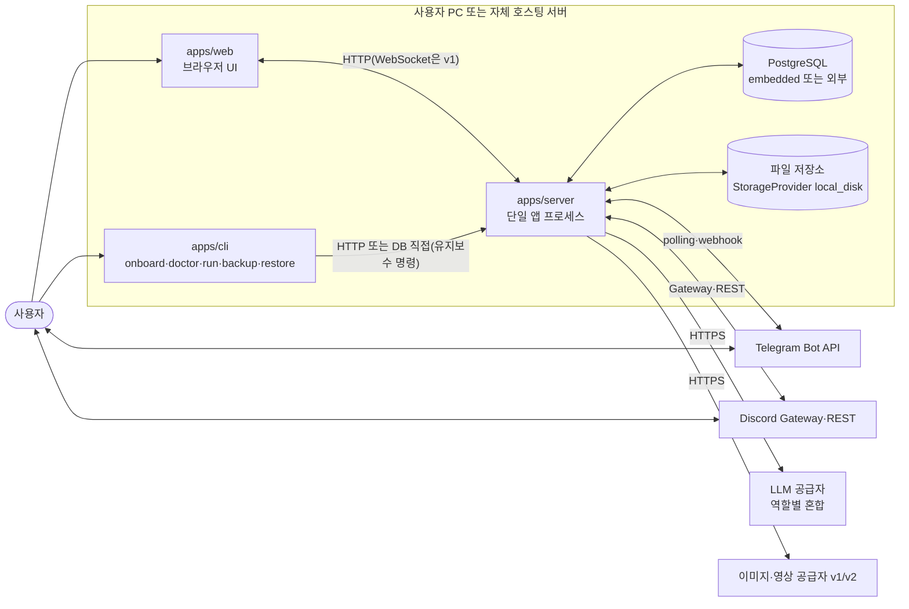
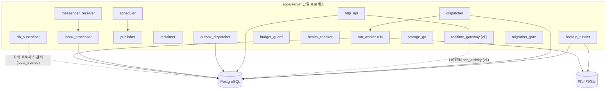
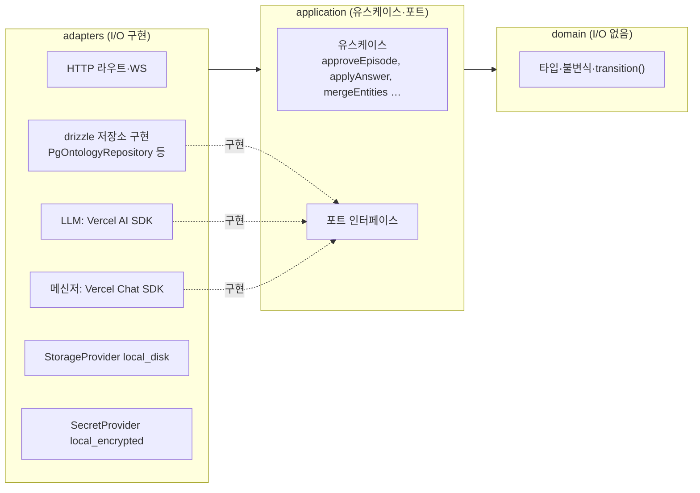
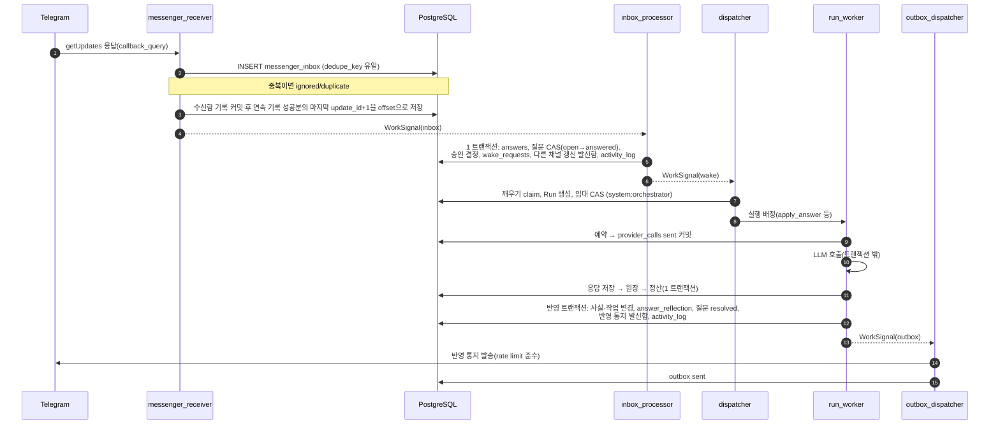
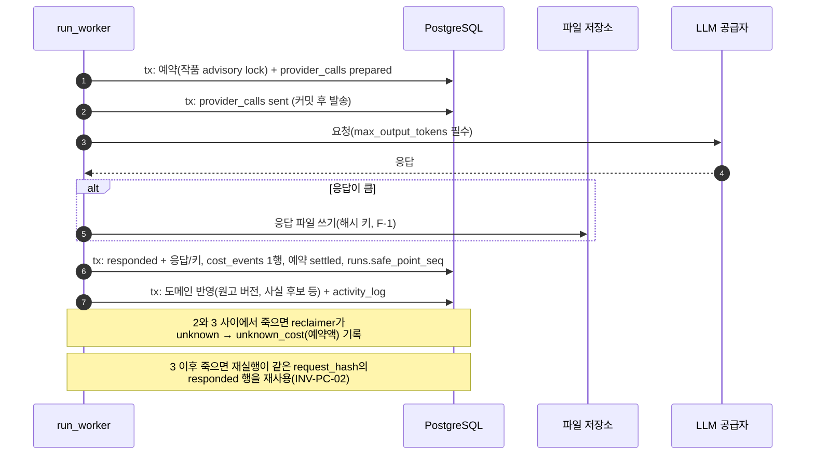
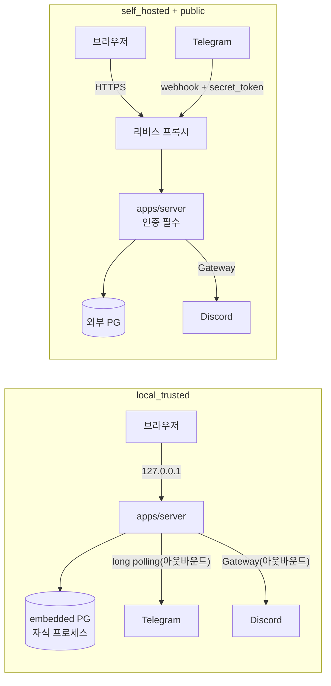
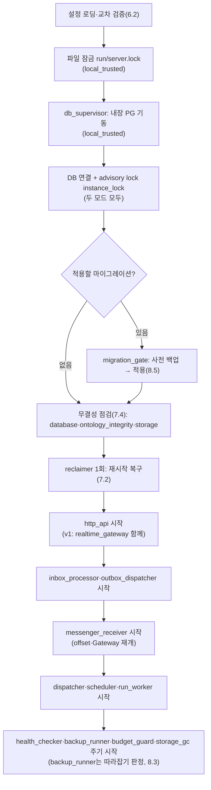
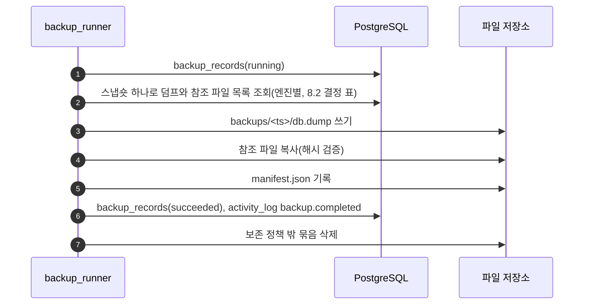
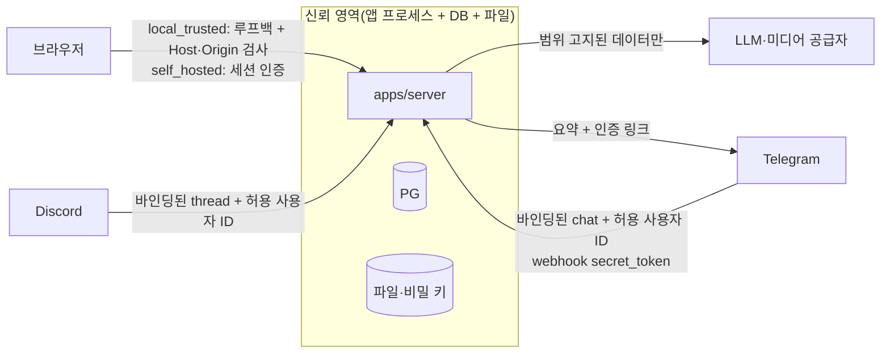

# 02. 시스템 아키텍처

| 항목 | 내용 |
|---|---|
| 문서 | novel-create-studio 상세 설계 02 |
| 버전 | v0.1 (2026-10-27) |
| 기준 | PRD v0.3, `00-foundation.md` v0.1, `03-domain-model.md` v0.1 |
| 작성 | AI 초안. 사람 검토 필요 |

**목적**: 제품을 어떤 프로세스와 계층으로 나누는지, 데이터를 어디에 두는지, 상태 변경이 어떤 경로로 퍼지는지, 장애가 나거나 다시 시작할 때 어떻게 되돌아오는지를 정합니다.

**범위**

| 다룸 | 다루지 않음 (참조) |
|---|---|
| 프로세스·내부 구성 요소, 배포 모드 `local_trusted`/`self_hosted` | 기술 버전 고정, 디렉터리 트리, 설정 키 이름, CLI 상세 → 08 |
| 계층 `adapters → application → domain`, 포트 목록, 모듈 사이 호출 규칙 | 엔티티 필드·불변식·상태 전이 → 03 |
| 저장소 구성(PG + 파일), **온톨로지(그래프)와 관계형 데이터의 정합성** | 온톨로지 스키마·질의·링킹 → 06 |
| 트랜잭션 경계, 이벤트·실시간 흐름 | 작업·실행·lease·비용 예약 알고리즘 → 04 |
| 시작·종료·재시작 복구, 장애 매트릭스, 백업·복원·업그레이드 | 메신저 어댑터 동작(수신 모드, 감독 루프, rate limit) → 05 |
| 보안 경계(NFR-SEC-01~05) | 화 파이프라인 단계 → 07 |

**관련 요구**

| 구분 | ID |
|---|---|
| 신뢰성 | NFR-REL-01~06, FR-AGT-02, FR-HIL-03, FR-MAN-06a, FR-MAN-06b(v1) |
| 보안 | NFR-SEC-01~05, R-12 |
| 성능·확장 | NFR-PERF-02~04, NFR-EXT-01, NFR-EXT-04a·04b, FR-UI-08 |
| 관측 | NFR-OBS-01·02, FR-SET-03 |
| 온톨로지 | FR-ONT-12~19, R-18, D-8, D-27, 5.7절 "온톨로지 저장소 손상" |
| 결정 | D-2, D-7, D-15, D-16, D-22 |
| ADR | ADR-002, 004, 005, 008, 009, 011, 015, 017, 018 (→ 00 3절) |

**선행 문서**: `00-foundation.md`(용어, ADR, 모듈, enum, 기본값), `03-domain-model.md`(집합체, 불변식, 감사 이벤트, 비용 흐름).

**표기**: PRD·00과 같습니다. **가정:** 은 실측·조사를 거치지 않은 전제, **[1차]/[2차]/[미확인]** 은 외부 사실의 근거 등급입니다. 외부 사실은 2026-10-27 조사 파일(Graph DB 후보, 엔티티 식별, Paperclip 소스 재확인 커밋 `0cb3fc7`)을 근거로 합니다. 이 문서에서 새로 쓰는 기본값 키·enum은 10절 "00 레지스트리 등록" 행에 모았고, 00 6절·7절에 등록되지 않은 것만 **제안**입니다.

---

## 1. 아키텍처 요약

| 결정 | 내용 | 근거 |
|---|---|---|
| A-1 단일 앱 프로세스 | `apps/server` 프로세스 하나가 HTTP·dispatcher·스케줄러·실행 worker·메신저 수신·발신(v1부터 웹소켓)을 모두 돌립니다. MVP는 `local_trusted`·`self_hosted` 두 모드 모두 같은 DB에 앱 프로세스 하나만 붙습니다(인스턴스 잠금 `instance_lock`, 2.3절). 다중 프로세스는 10절 미결입니다. | ADR-002, NFR-REL-06 |
| A-2 저장소 둘 | **PostgreSQL 데이터베이스 하나**(모든 구조화 데이터, 온톨로지 포함)와 **파일 저장소 하나**(`StorageProvider`, 바이너리·대용량 원문·백업). 그 밖의 저장소는 모두 파생이며 버려도 다시 만듭니다. | ADR-004, 005, 015 |
| A-3 원본은 PG | 세계관 그래프는 별도 엔진이 아니라 같은 PG의 온톨로지 테이블과 `OntologyRepository` 질의 계층입니다. 그래서 관계형↔그래프 이중 쓰기가 없고, 답변 반영·사실 쓰기·병합이 한 트랜잭션입니다. | ADR-005, R-18 |
| A-4 내구 큐는 DB 테이블 | 깨우기(`wake_requests`), 수신함·발신함(`messenger_inbox`/`outbox`), 외부 호출(`provider_calls`)이 큐 역할을 합니다. 메모리 신호는 지연을 줄이는 힌트일 뿐이고, 잃어도 주기 조회로 복구됩니다. | ADR-009, NFR-REL-01·02 |
| A-5 외부 I/O는 트랜잭션 밖 | LLM·미디어·메신저 호출과 파일 쓰기는 DB 트랜잭션 안에서 하지 않습니다. 호출 전 상태를 커밋하고, 응답을 먼저 저장한 뒤 반영합니다. | FR-AGT-02, INV-PC-01 |
| A-6 실시간은 감사 로그 순번 | MVP-α: 상태 변경 트랜잭션이 `activity_log`와 `seq`를 기록하고, UI는 주기·포커스 재조회로 갱신합니다(5.3.1절). v1: 같은 트랜잭션에서 `pg_notify`를 더하고, 커밋돼야 알림이 나가며, 클라이언트는 `seq`로 재연결 replay합니다(5.3.2절). | ADR-017, FR-UI-08(P1·v1) |

### 1.1 시스템 컨텍스트



---

## 2. 프로세스 구성

### 2.1 프로세스

| 프로세스 | 수명 | 역할 | 배포 모드 |
|---|---|---|---|
| `apps/server` (앱 프로세스) | 상시. OS 서비스(launchd·systemd·Windows 서비스, → 08)로 등록 | 아래 2.2절 구성 요소 전부 | 둘 다 |
| PostgreSQL (`embedded-postgres`) | 앱 프로세스의 자식. 앱이 띄우고 앱이 끕니다 | 데이터베이스 | `local_trusted` |
| PostgreSQL (외부) | 운영자가 관리. `DATABASE_URL`(이름 → 08) | 데이터베이스 | `self_hosted` |
| `apps/cli` | 명령 1회 | 설치·점검·서비스 등록·백업·복원 | 둘 다 |
| 리버스 프록시 (TLS 종단) | 운영자가 관리 | `exposure=public`일 때 HTTPS. 가정: 앱은 TLS를 직접 종단하지 않습니다 | `self_hosted` + `public` |

가정: `embedded-postgres`는 OS별 PG 바이너리를 자식 프로세스로 실행합니다 [1차] https://www.npmjs.com/package/embedded-postgres . 최신은 18.4.0-beta.17(2026-06-05)이고 beta입니다(ADR-004 위험). Paperclip이 같은 방식으로 로컬 PG를 운영하며 수명주기 코드(`embedded-postgres-{lifecycle,native,error}.ts` 228줄, `embedded-postgres-{owner,supervisor}.ts` 104줄)를 "그대로 차용" 대상으로 판단했습니다 [1차, 커밋 `0cb3fc7`] (→ 10).

### 2.2 앱 프로세스 안 구성 요소

| 구성 요소 | 책임 | 구동 방식 | 감사 로그 주체(`system_component`) | 상세 |
|---|---|---|---|---|
| `db_supervisor` | 내장 PG 기동·정지·감시, 남은 `postmaster.pid`·포트 충돌 처리 | 시작 시 1회 + 자식 종료 감시 | — | 2.4, 7절 |
| `migration_gate` | 마이그레이션 전 백업, 적용, 실패 시 복귀 | 시작 시 1회 | `migrator` | 8.5절 |
| `http_api` | REST API(`/api/...`), 정적 UI 제공, Telegram webhook·Discord interactions 수신 끝점(`self_hosted`) | 요청 구동 | 사용자 요청은 `user` | → 08 |
| `realtime_gateway` [v1] | 웹소켓 연결, `LISTEN`으로 감사 로그 알림 수신, replay. MVP-α에는 없습니다 | 상시 | — | 5.3.2절 |
| `dispatcher` | `orchestration` 모듈 루프. 깨우기 요청 claim, `Run` 생성, 실행 슬롯 확인, 작업 임대 획득(CAS), `run_worker` 배정 | 신호 + 주기 조회(`scheduler.poll_interval_seconds`, → 04 4.4) | `orchestrator` | → 04 4.4 |
| `scheduler` | 시각 기반 tick: 예약 공개·digest·리마인더·일일 요약 시각 도래 처리. 도래한 일은 깨우기 요청·발신함 행으로 만들고 직접 실행하지 않습니다 | 주기 조회 | `scheduler` | → 05, 07 |
| `run_worker` | 실행(`Run`) 수행: 임대 갱신, 컨텍스트 구성, 외부 호출, 결과 반영 | `dispatcher`가 배정, 동시 실행 상한(`run.max_concurrent_*`) | 실행 결과는 `agent` | → 04 |
| `reclaimer` | 만료 임대·고아 실행 회수, `sent`로 남은 호출의 `unknown` 처리 | 주기(`reclaim.scan_interval_seconds`) + 시작 시 1회 | `orchestrator` | 7.2절, → 04 |
| `messenger_receiver` | Telegram long polling 루프(`local_trusted`), Discord Gateway 감독 루프. 받은 즉시 `messenger_inbox`에 기록 | 상시 | `messenger` | → 05 |
| `inbox_processor` | 수신함 행을 해석해 답변·명령·바인딩으로 반영 | 신호 + 주기 조회 | `messenger` | → 05 |
| `outbox_dispatcher` | 발신함 행을 채널 어댑터로 보냄, rate limit·재시도 | 신호 + 주기 조회 | `messenger` | → 05 |
| `budget_guard` | 예약·한도 판정은 호출 경로 안에서(→ 03 7.4), 이 구성 요소는 창 경계(월 전환) 갱신과 경고 상태 재계산 | 주기 | `budget_guard` | → 03 7절 |
| `publisher` | 예약 공개(`publish_policy=scheduled`) 처리 | `scheduler`가 시각 도래 시 호출 | `publisher` | → 07 |
| `health_checker` | `health_check_kind` 점검 주기 실행, 결과 저장(`health_check_results`) | 주기(`channel.health_check_interval_minutes`) + 수동 | `health_check` | 7.4절, FR-SET-03 |
| `backup_runner` | 정기·업그레이드 전·복원 전 백업, 놓친 백업 따라잡기, 보존 정책 정리 | 주기(`backup.interval_hours`) + 이벤트(시작·절전 복귀 시 따라잡기, 8.3절) | `backup` | 8절 |
| `storage_gc` | 참조 없는 파일 정리(유예 시간 경과 후) | 주기 | — | 4.4절 |

규칙:
- 구성 요소는 서로 함수로 직접 부르지 않고 DB 상태와 신호(5.2절)로 협력합니다. 예외는 `dispatcher → run_worker` 배정과 `scheduler → publisher` 호출입니다.
- 감사 로그 주체는 깨우기 claim·`Run` 생성·임대 획득이 `system:orchestrator`(03 R1·T3, 04 W3), 시각 tick이 `system:scheduler`입니다.
- 모든 구성 요소는 시작 순서(7.1절)가 끝난 뒤에만 일을 받습니다. 종료 시에는 역순으로 멈춥니다(7.3절).



### 2.3 인스턴스 잠금 (단일 쓰기 프로세스)

| 항목 | 내용 |
|---|---|
| 목적 | 같은 데이터에 앱 프로세스 둘이 붙어 Telegram을 이중 polling하거나(공급자 쪽 충돌), 스케줄러가 둘이 되는 일을 막습니다. |
| 1단계 파일 잠금 | `local_trusted`: 설치 홈의 잠금 파일 `$NCS_HOME/run/server.lock`(PID + 포트, → 08 5.1·8.2)을 OS 배타 잠금으로 잡습니다. 실패하면 "이미 실행 중" 오류로 종료합니다. 가정: 잠금 구현 라이브러리는 → 08. |
| 2단계 DB 잠금 | 두 모드 모두: 전용 연결 하나에서 세션 advisory lock `instance_lock`(고정 키)을 `pg_try_advisory_lock`으로 잡습니다. 실패하면 종료합니다. 연결이 끊기면 잠금이 풀리므로, 이 연결이 끊기면 앱은 모든 구성 요소를 멈추고 재연결·재획득을 시도합니다(7.3절). |
| CLI | `backup`·`doctor`는 잠금 없이 읽기만 합니다. `restore`·마이그레이션은 앱이 꺼져 있을 때만 실행하거나, 실행 중인 앱에 HTTP로 요청해 앱이 처리합니다(8.4절). |
| 시작 복구 | 두 모드 모두 2단계 잠금을 얻으면 `runs.status ∈ {queued, running}`인 실행은 이전 프로세스의 것입니다. 임대 만료를 기다리지 않고 즉시 회수합니다(7.2절). |
| 다중 인스턴스 | MVP에서는 지원하지 않습니다. `self_hosted`에서도 앱 프로세스 1개이고 잠금 이름·적용 범위는 위와 같습니다. 가정: 단일 사용자·작품 3개(NFR-EXT-04b) 규모에서 수평 확장은 필요 없습니다. 필요해지면 구성 요소별 lease(Paperclip `chat_endpoint_leases` 패턴)로 나눕니다(10절 미결). |

### 2.4 내장 PG 수명주기 (`local_trusted`)

| 단계 | 동작 |
|---|---|
| 최초 설치 | `onboard`가 embedded 데이터 디렉터리 `$NCS_HOME/db/`(→ 08 5.1)에 클러스터를 `initdb`합니다. 인코딩 `UTF8`. 로캘은 S-5(한글 trigram) 결과에 따라 정합니다. Paperclip은 initdb·실행 환경에 `LC_MESSAGES=C`만 더하는 30줄 패치를 씁니다 [1차]. |
| 기동 | 루프백(`127.0.0.1`)에만 바인딩하고, 포트는 설정값(기본값 → 08)에서 비어 있지 않으면 다음 포트를 찾습니다. 남은 `postmaster.pid`가 죽은 프로세스를 가리키면 지우고 기동합니다(S-9). |
| 감시 | 자식이 예기치 않게 끝나면 모든 구성 요소를 멈추고(7.3절) 재기동을 최대 3회 시도합니다. 실패하면 OS 서비스 재시작에 맡기고, `health_status=fail`(`database`)을 남길 수 있으면 남깁니다. |
| 정지 | 앱 종료 순서의 마지막에 `fast` 모드로 정지합니다. |
| 확장 | 필수: `btree_gist`(범위 배타 제약). 선택: `pg_trgm`(이름 부분 일치), `pgvector`(이름 임베딩). 바이너리 포함 여부는 [미확인]이며 S-1에서 확인합니다. 선택 확장이 없으면 4.3절 대체 경로를 씁니다. |

---

## 3. 계층과 모듈 경계

### 3.1 계층 (ADR-008)



| 계층 | 가진 것 | 금지 |
|---|---|---|
| `domain` | 집합체 타입, 불변식 검사, 상태 전이 함수(→ 03 4절), 순수 계산(예약 상한, `story_point` 계산) | DB·네트워크·파일·시계 직접 접근. 시각은 인자로 받습니다 |
| `application` | 유스케이스, 포트 정의, 트랜잭션 경계 선언, 감사 로그 기록 호출 | SQL 작성, SDK 직접 import |
| `adapters` | 포트 구현, HTTP·WS 라우트, 메신저·LLM SDK 호출, 구성 요소 루프(2.2절) | 도메인 규칙 판단(전이 가드는 domain 호출) |

### 3.2 포트 목록

| 포트 | 소유 모듈 | 책임 | MVP 구현 | 교체 경계(NFR-EXT-01) |
|---|---|---|---|---|
| `UnitOfWork` | `system` | 트랜잭션 시작·커밋·롤백, 커밋 후 훅 등록, 직렬화 실패 재시도 | PG(postgres.js) | — |
| 모듈별 저장소(`EpisodeRepository` 등) | 각 모듈 | 집합체 읽기·쓰기. 첫 인자 `NovelScope`(T-3) | drizzle | — |
| `OntologyRepository` | `ontology` | 온톨로지 읽기·쓰기, 시점·시간선 필터 질의, 1~3홉 탐색 | `PgOntologyRepository` | 그래프 엔진 교체·투영 추가(4.5절) |
| `LlmAdapter` | `llm` | 호출 1회(→ ADR-010, 04) | AI SDK | 공급자·모델 |
| `MediaAdapter` [v1] | `media` | 이미지·영상 호출 1회(→ 07) | 공급자별 | 공급자·모델 |
| `MessengerAdapter` | `messaging` | 채널 중립 메시지 발송·수신 정규화(→ 05) | Chat SDK Telegram·Discord, `web` | 메신저 |
| `StorageProvider` | `system` | 파일 쓰기(쓰기 1회)·읽기·삭제·목록 | `local_disk` | S3 호환(이후) |
| `SecretProvider` | `system` | 비밀 저장·복호화 | `local_encrypted` | — |
| `Clock` | `system` | 현재 시각, 절전 복귀 감지(7.5절) | 시스템 시계 | 테스트용 가짜 시계 |
| `WorkSignal` | `system` | 커밋 후 프로세스 안 깨우기 힌트(5.2절) | 메모리 | — |

### 3.3 모듈 사이 호출

| 규칙 | 내용 |
|---|---|
| M-1 공개 API만 | 다른 모듈은 `modules/<m>/application/index.ts`의 함수만 부릅니다. 다른 모듈 테이블을 직접 조회하거나 쓰지 않습니다(ADR-008, 03 5.1절). |
| M-2 트랜잭션 전달 | 여러 모듈을 바꾸는 유스케이스는 호출한 쪽이 `UnitOfWork`로 트랜잭션을 열고, 상대 모듈 API에 트랜잭션 핸들(`tx`)을 넘깁니다. 상대 모듈은 자체 트랜잭션을 열지 않습니다. |
| M-3 동기 호출 vs 신호 | 불변식을 함께 지켜야 하면 같은 트랜잭션 안 동기 호출, 뒤따르는 작업이면 `WakeRequest` 행 생성(내구), 지연만 줄이려면 `WorkSignal`(비내구)입니다. 도메인 이벤트 버스(구독자 목록)는 두지 않습니다. 가정: 구독 관계가 코드 밖으로 숨어 디버깅이 어려워지는 것을 피합니다. |
| M-4 의존 방향 | 모듈 사이 순환 의존을 금지합니다. 허용 방향 예: `hitl → ontology`, `manuscript → ontology`, `orchestration → llm`, `* → audit`, `* → budget`. 검사 스크립트가 CI에서 강제합니다(→ 08). |
| M-5 감사 로그 | 상태를 바꾸는 유스케이스는 같은 트랜잭션에서 `audit.record(tx, …)`를 부릅니다(→ 03 6.2절). |

---

## 4. 데이터 저장소 구성

### 4.1 저장소 지도

| 저장소 | 종류 | 담는 것 | 원본 여부 | 백업 |
|---|---|---|---|---|
| PG 데이터베이스(하나) | 원본 | 작품·원고 버전 본문·씬·작업·실행·외부 호출 메타·질문·답변·승인·채널·수신함·발신함·예산·원장·감사 로그·**온톨로지 전부**·설치 단위 테이블(T-6) | 원본 | 8절 |
| 파일 저장소(`StorageProvider`) | 원본 | 미디어 에셋, 큰 외부 호출 응답(`response_storage_key`), 실행 상세 로그(`log_storage_key`), 내보내기 파일 | 원본(DB가 키·해시로 참조) | 8절 |
| 파일 저장소 `backups/` | 백업 | 백업 묶음 | 사본 | 보존 정책(`backup.retention`) |
| 비밀 마스터 키 파일 | 원본 | `local_encrypted` 키 | 원본(분리 보관) | 백업에 넣지 않음(8.2절) |
| 파생 데이터(4.3절) | 파생 | 요약, 임베딩, 검색 인덱스, 캐시 | 파생 | 넣어도 되고 빼도 됨 |

설치 홈 구조(루트 `$NCS_HOME`, 하위 이름의 단일 출처 → 08 5.1). `storage/` 아래 구조는 이 문서의 가정입니다.

```
$NCS_HOME/
  config.json               # 설정(비밀 값 없음, → 08 5.1)
  db/                       # local_trusted 내장 PG 클러스터(embedded 데이터 디렉터리)
  storage/
    installation/           # 설치 단위 파일(로그 원문 등)
    novels/<novel_id>/      # 작품 단위. 작품 삭제(T-7) 시 디렉터리째 삭제
      provider_responses/   # 키 = 내용 해시
      run_logs/
      media/                # v1
      exports/
  backups/
  secrets/master.key        # 권한 0600
  logs/                     # 앱 로그(pino), 비밀 가림
  run/server.lock           # 1단계 파일 잠금(2.3절)
```

### 4.2 온톨로지(그래프)와 관계형 데이터의 정합성

**원본 규칙**

| # | 규칙 |
|---|---|
| G-1 | 세계관 그래프의 원본은 PG 안 온톨로지 테이블(`entities`, `entity_names`, `mentions`, `facts`, `fact_versions`, `timelines`, `ontology_schema_versions`, `schema_change_proposals`, `glossary_terms`, `identity_decisions`)입니다(ADR-005). 별도 그래프 엔진은 MVP에 없습니다. |
| G-2 | 관계형 쪽(씬, 떡밥, 질문, 반영 기록, IR)은 온톨로지 노드를 **ID로만** 참조합니다(→ 03 5.1절). 이름 문자열로 엔티티를 가리키는 컬럼은 만들지 않습니다(FR-ONT-12, ADR-006). |
| G-3 | 작품 소속 온톨로지 테이블도 `novel_id`와 복합 외래 키(T-1, T-2)를 가집니다. 관계형↔온톨로지 사이 외래 키도 DB가 겁니다. 같은 DB라 가능합니다. |
| G-4 | 온톨로지 쓰기는 `ontology`·`linking` 모듈의 application API로만 합니다. 다른 모듈은 같은 트랜잭션 핸들로 이 API를 부릅니다(M-2). |
| G-5 | 시간 범위·개수 제약 중 DB가 강제할 수 있는 것(같은 칭호 보유 기간 겹침 금지, 엔티티당 대표명 1개, 작품당 기본 시간선 1개)은 DB 제약(`EXCLUDE USING gist`, 부분 유일 인덱스)으로 둡니다. 나머지(정의역·치역, 사망 후 관계 금지 등)는 `continuity` 모듈의 결정적 검사(`issue_detector=schema_validator`)가 맡습니다(→ 06). |
| G-6 | 이름(`EntityName`)·요약·임베딩은 엔티티 동일성을 정하지 않습니다. 동일성 변경은 `IdentityDecision` 적용 트랜잭션으로만 합니다(FR-ONT-15, 16). |

**트랜잭션 경계**

| 유스케이스 | 한 트랜잭션에 묶는 쓰기 | 트랜잭션 밖 | 잠금·충돌 처리 | 상세 |
|---|---|---|---|---|
| 메신저 업데이트 수신 | `messenger_inbox` INSERT(`dedupe_key` 유일) | 공급자 ACK(Discord 3초), Telegram offset 저장은 수신함 기록 커밋 후 별도 커밋(배치에서 앞에서부터 연속 기록에 성공한 분까지, 처리 완료를 기다리지 않음, → 05 9.2 TP2·TP3) | 유일 제약 충돌 = 중복(`ignored/duplicate`) | → 05 |
| 답변 채택 | 수신함 `processed`, `answers`, 질문 상태, (승인 질문이면) `approvals` 결정(ADR-014), 다른 채널 `question_deliveries`·발신함 갱신 행, `wake_requests`, 감사 로그 | 해석 LLM 호출(이후 실행에서) | 질문 행 CAS(`status=open`일 때만 채택), 늦은 답은 `late` | → 05 |
| 답변 반영(`apply_answer`) | 사실·사실 버전·이름 사전·작업 변경, `answer_reflections`·`answer_reflection_items`, 질문 `resolved`, 반영 통지 발신함 행, 감사 로그 | 반영 통지 실제 발송 | 대상 행 `FOR UPDATE` | → 05, 06 |
| 화 승인(E9 등) | 화 상태, 승인, 사실·떡밥 비트 캐논 승격(`ontology.promoteEpisodeFacts`, 이름 → 06), 감사 로그 | — | 화 행 `FOR UPDATE`. 사실 승격의 개수 1 슬롯 쓰기는 06 2.5 SL-1~SL-4(작품 슬롯 advisory lock, 사전 겹침 검사, 충돌·`23P01`은 롤백 대신 `candidate` 유지 + CR-09 이슈로 전환, 화 승인은 계속) | → 03 4.1, 06 2.5, 07 |
| 링킹 결과 기록 | `mentions` 일괄, 신규 엔티티 후보, `ambiguous` 판별 질문 생성, 감사 로그 1행 | 링커 LLM 호출(앞선 `ProviderCall`) | 이름 사전 읽기는 같은 스냅숏 | → 06 |
| 엔티티 병합·분리 적용 | `identity_decisions` `applied`, `entities.status=merged`·`merged_into_id`, 참조 이동(사실, 언급, 씬 등장, 떡밥 링크, 질문 링크, 시각 자산), 이동 목록 기록, 감사 로그 | — | 대상 엔티티 행을 ID 순서로 `FOR UPDATE`(교착 방지). 진행 중 실행의 쓰기는 4.2 "병합 중 쓰기" 규칙 | → 06, S-6 |
| 예산 예약 | 정책 확인, `budget_reservations` | — | 작품 단위 advisory lock(→ 03 7.4) | → 04 |
| 외부 호출 | (a) `provider_calls` `prepared`→`sent` 커밋 (b) 응답 저장·원장·예약 정산 1 트랜잭션 | 공급자 호출, 큰 응답 파일 쓰기 | `idempotency_key` 유일 | → 03 7.4, 04 |
| 임대 획득 | 조건부 UPDATE 한 문장(CAS) | — | INV-TSK-03 | → 04 |

**병합 중 쓰기**: 실행이 시작할 때 만든 `ContextSnapshot`에는 병합 전 엔티티 ID가 들어 있을 수 있습니다. 실행이 결과(사실·언급)를 쓸 때 `ontology` API가 같은 트랜잭션에서 `merged_into_id`를 따라 현재 ID로 바꿔 씁니다. 바꾼 경우 결과 행에 원래 ID를 함께 남겨 추적합니다(`mentions.redirected_from_entity_id`, `fact_versions.content.written_for_entity_ids`, → 06 3.11). 분리(`split`)는 자동 재지정 대상이 없으므로, 분리된 엔티티를 참조하는 진행 중 실행은 결과 반영 단계에서 `superseded`로 끝내고 작업을 다시 큐에 넣습니다(→ 04).

**격리 수준**: 기본 `READ COMMITTED`입니다. 정합성은 행 잠금, CAS, 유일·배타 제약으로 지킵니다. `UnitOfWork`는 직렬화 실패(`40001`)·교착(`40P01`)이면 트랜잭션 전체를 `db.tx_retry_max`회까지 다시 실행합니다. 트랜잭션 안 문장 시간은 `db.statement_timeout_ms`로 제한합니다. 두 키는 00 7.2에 등록돼 있습니다.

### 4.3 파생 데이터와 재구축

| 파생 데이터 | 원본 | 저장 위치 | 갱신 시점 | 오래됨 판정 | 재구축 |
|---|---|---|---|---|---|
| 엔티티 요약 `entities.summary` | 캐논 사실 버전 | PG 컬럼 | 해당 엔티티 사실 승격 후 깨우기 | 요약에 쓴 사실 버전 ID 집합의 해시가 현재와 다름 | LLM 재생성(비용 발생, 예약 경유). 컨텍스트 구성은 오래된 요약을 쓰지 않고 사실을 직접 넣습니다 |
| 이름 정규화 키 `entity_names.normalized_key` | `surface` | PG 컬럼 | 쓰기 시 결정적 계산 | 정규화 규칙 버전 변경 | 결정적 일괄 재계산(무비용) |
| 이름 부분 일치 인덱스 | `entity_names` | PG GIN(`pg_trgm`) | PG가 자동 유지 | — | `REINDEX`. `pg_trgm`이 없거나 한글 trigram이 안 되면(S-5) 정규화 키 + 접두 인덱스로 대체 |
| 이름 임베딩(링킹 L2 후보 생성) | `entity_names`, 엔티티 요약 | `pgvector`가 있으면 PG 테이블, 없으면 앱 메모리 인덱스(가정) | 이름 추가·요약 변경 후 | 임베딩 모델 ID·입력 해시 불일치 | 재계산(비용 발생). 메모리 인덱스는 시작 시 PG의 저장 벡터로 다시 만듭니다. 가정: 벡터 값 자체는 PG `bytea`/배열로 저장 |
| 실행 비용 캐시 `runs.cost_micros` | `cost_events` | PG 컬럼 | 원장 기록 트랜잭션 | 합계 불일치 | 원장 합으로 재계산 |
| 예산 상태 `budget_policies.status` | 원장 + 활성 예약 | PG 컬럼 | 예약·정산 트랜잭션, `budget_guard` | 재계산 결과와 다름 | 재계산 |
| 컨텍스트 스냅숏 | — | PG | 실행당 1회 | 불변(파생이 아니라 기록) | 재구축하지 않음 |
| 그래프 투영(조건부, 4.5절) | 온톨로지 테이블 | LadybugDB 파일 또는 AGE 그래프 | 투영 작업 | 투영 수위 < 요구 수위 | 전체 재투영 |

규칙: 파생 데이터는 백업·복원·작품 패키지 이동 후 다시 만들 수 있어야 하고, 파생 데이터가 없거나 오래돼도 **정확성**은 유지돼야 합니다(느려지거나 후보가 줄 수는 있음). 엔티티 동일성·캐논 판정에 파생 데이터만 근거로 쓰지 않습니다(G-6).

### 4.4 DB와 파일 저장소 사이 정합성

| 규칙 | 내용 |
|---|---|
| F-1 쓰기 순서 | 파일을 먼저 씁니다(임시 이름 → fsync → 최종 키로 rename). 그다음 DB 행이 키와 `content_hash`를 참조하도록 커밋합니다. |
| F-2 키 불변 | 저장 키는 내용 해시 기반이고 파일은 덮어쓰지 않습니다. 같은 키에 다른 내용이 올 수 없습니다. |
| F-3 고아 파일 | F-1 사이에서 죽으면 참조 없는 파일이 남습니다. `storage_gc`가 `storage.orphan_gc_grace_hours`(00 7.7, 가정 48시간, `backup.interval_hours`보다 깁니다)가 지난 고아 파일만 지웁니다. |
| F-4 삭제 | DB 행 삭제·대체가 먼저 커밋되고, 파일은 F-3 유예 뒤 지웁니다. 그래서 백업 시점의 DB가 참조하는 파일은 백업 복사 중에도 남아 있습니다(8.2절). 예외: 작품 삭제(T-7, NFR-SEC-05)는 즉시 디렉터리째 지웁니다. |
| F-5 무결성 점검 | `health_checker`(`storage`)가 표본 파일의 존재와 해시를 확인합니다. 누락 파일은 참조 행에 오류를 표시하고 사용자에게 알립니다. |

### 4.5 그래프 투영을 추가할 때의 정합성 규칙 (조건부)

ADR-005 재검토 조건 (1)(2)가 충족되면 PG를 원본으로 둔 채 읽기 전용 투영(LadybugDB 또는 Apache AGE)을 붙입니다. MVP에는 없습니다. 붙일 때 아래를 지킵니다.

| # | 규칙 |
|---|---|
| P-1 | 쓰기는 항상 PG입니다. 투영에 직접 쓰는 경로를 만들지 않습니다. |
| P-2 | 투영은 PG만으로 처음부터 다시 만들 수 있어야 합니다. 백업에 넣지 않습니다. LadybugDB는 마이너 버전마다 저장소 형식이 바뀌므로 [1차] https://docs.ladybugdb.com/migrate/ , 앱 업그레이드 때 이전하지 않고 재투영합니다. |
| P-3 | 투영은 반영한 변경의 수위(watermark)를 가집니다. `OntologyRepository`의 읽기 메서드는 호출자가 요구한 수위(예: 실행 시작 시점)보다 투영이 뒤처져 있으면 PG 경로로 답합니다. 수위 추적 방식(변경 기록 테이블 등)은 → 06 O-17에서 정합니다. |
| P-4 | 캐논·동일성 판정(병합 여부, 칭호 보유자, 사실 유효성)은 투영이 아니라 PG 질의로 합니다. 투영은 다홉 탐색·관계도 같은 읽기 부하에만 씁니다. |
| P-5 | 투영 이상은 무결성 실패가 아니라 성능 저하로 취급합니다(투영을 끄고 PG로 답함). |
| P-6 | LadybugDB는 쓰기 가능한 프로세스가 하나뿐입니다 [1차] https://docs.ladybugdb.com/concurrency/ . 앱 프로세스 하나(2.3절)가 소유합니다. |

---

## 5. 이벤트·실시간 흐름

### 5.1 세 종류의 흐름

| 흐름 | 매체 | 내구성 | 소비자 | 용도 |
|---|---|---|---|---|
| 감사·실시간 이벤트 | `activity_log` 행(MVP-α) + 같은 트랜잭션 `pg_notify('ncs_activity', seq)`(v1) | 행은 내구, 알림은 비내구 | MVP-α: 브라우저 재조회(5.3.1). v1: `realtime_gateway` → 브라우저 | UI 갱신 힌트, 감사(NFR-OBS-01, FR-UI-08) |
| 일 큐 | `wake_requests`, `messenger_inbox`, `messenger_outbox`, `provider_calls`, `tasks`(임대) | 내구 | `dispatcher`, `run_worker`, `inbox_processor`, `outbox_dispatcher`, `reclaimer` | 실제 작업 진행 |
| 깨우기 힌트 | `WorkSignal`(프로세스 메모리, 커밋 후 훅) | 비내구 | 위 큐 소비자 | 주기 조회를 기다리지 않게 지연 단축 |

원칙:
- 업무 로직은 감사 로그를 큐로 소비하지 않습니다. 감사 로그 알림을 놓쳐도 UI가 늦게 갱신될 뿐 작업은 진행됩니다.
- 큐 소비자는 힌트를 받으면 즉시, 힌트가 없어도 `scheduler.poll_interval_seconds`(00 7.2, 가정 5초)마다 DB를 조회합니다. 그래서 힌트 유실(프로세스 재시작, CLI가 쓴 변경)은 최대 이 간격만큼 늦어질 뿐입니다.
- 브라우저는 실시간 이벤트(v1)를 상태로 쓰지 않고 "다시 가져올 대상" 신호로만 씁니다. 화면 상태는 MVP-α·v1 모두 항상 REST API로 가져옵니다(React Query, → 08).

### 5.2 커밋 후 처리 (`UnitOfWork`)

| 단계 | 동작 |
|---|---|
| 1 | 유스케이스가 트랜잭션 안에서 상태를 바꾸고, `audit.record`가 `activity_log`에 행을 씁니다. v1부터는 같은 호출이 `pg_notify('ncs_activity', <seq>)`도 실행합니다. PG는 NOTIFY를 커밋 시점에만 전달합니다. |
| 2 | 유스케이스가 `tx.afterCommit(() => WorkSignal.notify(kind, novel_id))`를 등록합니다. |
| 3 | 커밋 성공 시 훅을 실행합니다. 롤백이면 훅을 버립니다. |
| 4 | 훅 안에서는 외부 I/O를 하지 않습니다. 발송은 발신함 행으로 이미 커밋돼 있고, `outbox_dispatcher`가 보냅니다. |

### 5.3 화면 갱신 (FR-UI-08, ADR-017)

FR-UI-08(실시간 갱신)은 PRD상 P1·v1이고 09 V1-2에 있습니다. MVP-α는 ADR-017의 데이터 측면(`activity_log`·`seq` 기록)만 갖추고, 전달 경로는 v1에 붙입니다.

#### 5.3.1 MVP-α: 주기·포커스 재조회

| 항목 | 내용 |
|---|---|
| 방식 | React Query `refetchInterval` + 창 포커스 재조회(`refetchOnWindowFocus`). 웹소켓·`pg_notify`·`LISTEN`은 쓰지 않습니다. |
| 주기 대상 | 인박스, 작업 보드만 `refetchInterval` 5초(가정, `ui.poll_interval_seconds`, 00 7.7). 그 밖의 화면(작품 홈, 원고, 온톨로지, 감사 타임라인)은 포커스 재조회와 자기 변경 후 무효화만 씁니다. |
| 근거 | 로컬 단일 사용자 앱이고 MVP-α 화면에는 다른 탭·메신저 변화가 몇 초 늦게 보여도 되는 요구만 있습니다. 가정: 5초 주기 조회 2개의 DB 부하는 무시할 수 있습니다. |
| 데이터 준비 | `activity_log.seq`는 MVP-α부터 기록하므로 v1 전환 때 데이터 이전이 없습니다. |

#### 5.3.2 v1: 실시간 전달

| 항목 | 내용 |
|---|---|
| 연결 | 웹소켓 `/api/live`. 연결 시 `{novel_ids, after_seq}`를 보냅니다. `self_hosted`는 세션 인증 후에만 업그레이드합니다. |
| 서버 수신 | `realtime_gateway`가 전용 연결에서 `LISTEN ncs_activity`. 알림을 받으면 `seq > 마지막 전달 seq`인 행을 구독 작품 기준으로 읽어 보냅니다. 다른 프로세스(CLI 복원 등)가 쓴 변경도 같은 경로로 옵니다. |
| 전달 형식 | `{seq, action, novel_id, target_type, target_id, occurred_at}`. `before`/`after` 본문은 보내지 않습니다(가림 처리된 값도 보내지 않음, NFR-SEC-02). |
| 재연결 | 클라이언트가 마지막 `seq`를 보내면 그 뒤를 replay합니다. 요청한 `seq`와 현재 최대 `seq` 차이가 `realtime.replay_max_events`(00 7.7, 가정 1,000)보다 크면 "전체 새로고침" 신호만 보냅니다. |
| 순번 공백 | `seq`는 INSERT 시점에 정해지고 커밋 순서와 다를 수 있습니다. 그래서 공백(`seq` 10을 보지 못했는데 11이 보임)을 만나면 공백 뒤 이벤트를 `realtime.gap_wait_ms`(00 7.7, 가정 2,000ms) 동안 보류합니다. 그사이 공백이 채워지면 순서대로 보내고, 아니면 롤백된 번호로 보고 넘깁니다. 이 때문에 드물게 이벤트가 빠질 수 있지만, 5.1절 원칙(이벤트는 힌트)과 재연결 시 재조회로 화면 상태는 맞춰집니다. |
| 목표 | 다른 탭·메신저에서 생긴 변화가 p95 5초 안에 보임(`ui.realtime_p95_seconds`). 경로 지연 합 = 커밋 → NOTIFY → 조회 → 전송, 공백 대기 최대 2초. 가정: 로컬 환경에서 충분합니다. v1(V1-2) 실측(D-22). |
| 하트비트 | 30초(가정)마다 ping. 응답이 없으면 연결을 닫고 클라이언트가 재연결합니다. |

### 5.4 대표 흐름

**메신저 답변 → 반영 → 재개**



Telegram polling의 offset 저장 시점은 "수신함 INSERT 커밋 후"입니다. 업스트림 Chat SDK polling은 offset을 메모리에만 두고 처리 완료 전에 넘깁니다 [1차, `@chat-adapter/telegram` 4.39.0 `dist/index.js`]. 그래서 수신 루프를 감싸 offset을 DB(`messenger_bots.telegram_update_offset`)에 두고, 수신함 기록 커밋 후 연속 기록 성공분까지만 넘깁니다(처리 완료를 기다리지 않음, ADR-011, → 05 9.2 TP2·TP3).

**실행과 외부 호출 (재시작 안전)**



---

## 6. 배포 모드

### 6.1 모드 비교 (ADR-002, NFR-SEC-03)

| 항목 | `local_trusted` (기본) | `self_hosted` |
|---|---|---|
| 대상 | 사용자 PC, 단일 사용자 | 개인 서버(가정: 홈 서버·VPS), 단일 사용자 |
| 릴리스 | MVP-α | MVP-β(MB-5, → 09 3.2) |
| `exposure` | `private` 강제 | `private` 또는 `public` |
| HTTP 바인딩 | `127.0.0.1`만 | 설정값. `public`이면 리버스 프록시 뒤 |
| 인증 | 없음(루프백 + Host·Origin 검사, 9.3절) | 필수(세션 로그인, 방식 → 08) |
| DB | `embedded-postgres` 자식 프로세스 | 외부 PG(`DATABASE_URL`). 필수 확장 `btree_gist` |
| Telegram 수신 | long polling(`telegram_receive_mode=polling`) | webhook + `secret_token`(`webhook`). 공개 HTTPS 필요 [1차, PRD 11절] |
| Discord 수신 | Gateway(아웃바운드 WebSocket, 공개 URL 불필요) + 감독 루프 | 같음 |
| 메신저 링크(NFR-SEC-04) | `http://127.0.0.1:<port>/…` 링크. **같은 PC에서만 열립니다**(제약, 6.3절) | 설정한 공개 기준 URL. 인증 필요 |
| 비밀 | `local_encrypted` | `local_encrypted`(마스터 키는 파일 또는 환경 변수, → 08) |
| 파일 저장소 | `local_disk` | `local_disk`(이후 S3 호환) |
| 백업 | `backup_runner` → `$NCS_HOME/backups` | 같음. 외부 PG면 `pg_dump` 클라이언트 버전이 서버 이상이어야 함(가정) |
| 절전 | 절전 중 실행·수신 정지, 복귀 후 재개(7.5절) | 상시 |

### 6.2 설정 교차 검증

설정 교차 검증 규칙(CFG-1~8)의 단일 출처는 → 08 5.3입니다. 시작 시 위반이면 기동하지 않습니다(CFG-7·8은 정해진 조치 후 기동). 이 문서가 기대는 규칙은 `local_trusted` ⇒ `exposure=private`·루프백·인증 끔(CFG-1), `self_hosted` ⇒ 인증 켬(CFG-2), `exposure=public` ⇒ https 공개 기준 URL·리버스 프록시 신뢰 설정(CFG-3), `webhook` ⇒ `self_hosted` + `public`이고 `local_trusted`는 polling 고정(CFG-4), 외부 PG ⇒ `btree_gist`(CFG-5), 마스터 키 없음 처리(CFG-8, 8.2절)입니다.

### 6.3 모드별 제약과 안내

| 제약 | 영향 | 대응 |
|---|---|---|
| `local_trusted` 링크는 다른 기기에서 열리지 않음 | 휴대폰 메신저에서 "전문 보기" 링크를 눌러도 열리지 않음 | 메신저 메시지는 답변에 필요한 요약을 담고(NFR-SEC-04), 링크는 "PC에서 열기"로 표시. 원격 열람은 `self_hosted` 또는 사용자 VPN(가정)으로 안내. 휴대폰에서 화 전문을 읽어야 하면 화 전문 첨부 옵트인(기본 꺼짐, → 05 9.7) |
| PC 절전·종료 중 수신 정지 | 질문 발송·수신 정지, Telegram 미수신 업데이트 24시간 후 유실 가능 [1차, PRD 11절] | 설정 화면 안내(NFR-REL-06), 복귀 시 유실 가능 알림(7.5절), 웹 인박스로 보완(NFR-REL-02) |
| Telegram webhook은 공개 HTTPS 필요 | 로컬에서 webhook 불가 | `local_trusted`는 polling 고정(08 5.3 CFG-4) |



---

## 7. 장애·재시작·복구

### 7.1 시작 순서



- s6에서 `ontology_integrity`가 `fail`이면 해당 작품을 `pause_reason=ontology_integrity`로 일시정지하고 나머지 작품은 계속합니다(5.7절 "캐논 없이 집필하지 않음"). 설치 단위 `database` 실패면 기동을 멈추고 복원 안내만 띄웁니다.
- 수신(s10)을 일 처리(s11)보다 먼저 시작하는 이유: 답변이 먼저 들어와야 차단된 작업이 풀린 상태로 스케줄링됩니다.

### 7.2 재시작 복구 (NFR-REL-01, FR-AGT-02)

시작 시 `reclaimer`가 한 번, 이후 주기적으로 같은 규칙을 적용합니다. 규칙은 상태 테이블만 보고 판단합니다. 주기 회수는 이 프로세스의 활성 실행 레지스트리(→ 04 LR-1)에 있는 실행과 그 임대·예약을 건너뜁니다(→ 04 LR-2).

| 대상 | 남은 상태 | 복구 동작 | 근거 |
|---|---|---|---|
| `runs` | `running`(이 프로세스 이전 실행. 두 모드 모두 잠금 획득 후 임대 만료를 기다리지 않음, 2.3절. `queued` 처리 → 04 11절) | `interrupted`, `stop_reason=lease_lost`. 작업 임대 해제, 작업 `ready` + 깨우기(`reason=reclaim`) | INV-TSK-02, → 04 |
| `provider_calls` | `sent` | `unknown` → `CostEvent(cost_basis=unknown, 금액=예약액)` → 예약 `unknown_closed`, `cost.unknown_recorded` | 03 7.4 단계 6 |
| `provider_calls` | `prepared` | 발송 전이므로 예약 `released`, 행은 재실행이 재사용하거나 버림 | — |
| `provider_calls` | `responded`, 도메인 미반영 | 재실행이 같은 `request_hash`로 재사용(재호출 없음) | INV-PC-02 |
| `budget_reservations` | `active`, 연결 호출 없음, `budget.reservation_stale_after_minutes` 경과. 활성 실행 레지스트리(04 LR-1)에 있는 실행의 예약은 제외 | `released` | → 04 8절 |
| `tasks` | 임대 만료(`lease_expires_at < now()`) | 실행 종료 확인 후 회수(FOR UPDATE는 이 경로에서만, ADR-009) | → 04 |
| `messenger_inbox` | `processing` | `retry`로 되돌려 다시 처리(처리는 멱등: 질문 CAS·답변 유일 키) | INV-IN-01 |
| `messenger_outbox` | `sending` | `delivery_unknown`(자동 재발송 안 함). 질문이면 웹 인박스에 그대로 있고, 리마인더·digest 경로가 사람에게 다시 알림 | INV-OUT-01 |
| `wake_requests` | `claimed`, 실행이 `interrupted` | 새 깨우기로 대체(`reclaim`) | → 04 |
| `backup_records` | `running` | `failed`(사유: 중단). 미완성 파일 삭제 | 8절 |
| 일시정지 중 실행 | `paused_at` 있음 | 새 실행 시작 안 함(INV-NOV-03) | FR-HIL-03 |

검증: MVP-α 완료 기준 (4) "강제 종료·재시작 후 상태 손실 없음, 원장 중복 0건, 중단 호출이 `unknown_cost`로 기록"을 각 경계(5.4절 두 번째 그림의 1~4 사이)에서 프로세스를 죽이는 테스트로 확인합니다(→ 08 품질 게이트, 09).

### 7.3 정상 종료

| 순서 | 동작 |
|---|---|
| 1 | 신호(SIGTERM·서비스 정지) 수신. `dispatcher`가 새 실행 배정을, `scheduler`가 시각 tick을 멈춥니다. `messenger_receiver`는 받은 업데이트를 수신함에 기록한 뒤 멈춥니다. |
| 2 | 진행 중 실행에 정지 요청. 실행은 안전 지점(진행 중 외부 호출의 응답 저장, `safe_point`)에서 멈춥니다(FR-HIL-03). `shutdown.grace_seconds`(00 7.2, 가정 60초)를 넘기면 그대로 끝내고 7.2절 복구에 맡깁니다. |
| 3 | `outbox_dispatcher`는 진행 중 발송 1건을 끝내고 멈춥니다. |
| 4 | HTTP(v1: 웹소켓 포함) 종료, advisory lock 해제, DB 연결 종료. |
| 5 | 내장 PG 정지(`fast`), 파일 잠금 해제. |

DB 연결 유실(인스턴스 잠금 연결 포함) 시에도 1~3을 수행한 뒤 재연결을 시도하고, 성공하면 7.1절 s3부터 다시 시작합니다.

### 7.4 무결성 점검 (`health_check_kind`)

| 종류 | 점검 내용 | 실패 시 |
|---|---|---|
| `database` | 연결, 마이그레이션 버전 일치, 필수 확장 | 기동 중단·복원 안내 |
| `ontology_integrity` | (1) `merged` 엔티티를 가리키는 현재 참조 0건 (2) 활성 엔티티당 대표명 정확히 1개 (3) `auto_linked`·`confirmed` 언급에 `linked_entity_id` 있음 (4) 캐논 사실의 `predicate`가 기록된 스키마 버전에 있음 (5) `facts.current_version_no`와 최신 버전 행 일치 (6) 작품 사이 참조 0건(T-2가 막지만 재확인). 질의 목록 → 06 | 해당 작품 `pause_reason=ontology_integrity`, 차단형 알림, 마지막 백업 시각 표시(5.7절) |
| `storage` | 쓰기 가능, 여유 공간(가정: 1GB 미만이면 `warn`), 표본 해시 | `warn`이면 알림, `fail`이면 미디어·백업 작업 일시정지 |
| `backup_location` | 쓰기 가능, 마지막 성공 백업이 RPO(24시간) 이내, 백업 경로가 `$NCS_HOME`(데이터)과 다른 디스크인지 | RPO 초과면 따라잡기 백업(8.3) + 알림. 같은 디스크면 `warn`이고 설정 화면에 "RPO는 디스크 고장 제외" 표시(8.2) |
| `llm_key`, `bot_token`, `channel_reach` | 공급자 점검 | → 04, 05 |

DB 제약(G-5)이 막는 위반은 쓰기 시점에 거부되므로 점검 대상이 아닙니다. 점검은 앱 계층에서 지키는 규칙과 버그로 생길 수 있는 불일치를 찾습니다.

### 7.5 장애 매트릭스

| 장애 | 감지 | 즉시 동작 | 복구 | 사용자 통지 | 관련 |
|---|---|---|---|---|---|
| 앱 프로세스 강제 종료 | OS 서비스 재시작 | — | 7.1 → 7.2 | 없음(재시작 후 정상). 중단 호출은 비용 화면에 `unknown_cost` | NFR-REL-01 |
| 내장 PG 자식 종료 | `db_supervisor` 자식 종료 감시 | 구성 요소 정지(7.3) | 재기동 3회, 실패 시 서비스 재시작 | 반복 실패 시 웹 배너 | S-9 |
| DB 손상·복원 필요 | 시작 시 점검, 쿼리 오류, 내장 PG 기동 실패 | 기동 중단 또는 작품 일시정지 | 백업 복원(8.4). 클러스터가 기동하지 않으면 8.4 "클러스터 기동 불가" 분기 | 차단형 알림, 마지막 백업 시각 | 5.7절, NFR-REL-04 |
| PC 절전·복귀 | `Clock`이 단조 시계와 벽시계 차이 > `system.sleep_detect_gap_seconds`(00 7.7, 가정 120초) 감지 | 활성 실행 임대 즉시 갱신(→ 04 LR-3) 후 `reclaimer` 1회 | 임대 만료 재평가(레지스트리 실행 제외, 04 LR-2), 메신저 수신 재연결(→ 05 9.2 TP7), 마지막 성공 백업이 `backup.interval_hours`를 넘었으면 따라잡기 백업을 큐에 넣음(8.3) | 공백이 24시간 이상이면 "Telegram 미수신 업데이트 유실 가능" 정보성 알림 + 웹 인박스 안내 | NFR-REL-02, 06 |
| 시스템 시각 역행 | 단조 시계 대비 | 임대·마감 계산은 DB `now()` 기준이라 영향 제한 | — | 없음 | 가정 |
| 디스크 가득 | 쓰기 오류, `storage` 점검 | 실행·백업 일시정지(`pause_reason=maintenance`) | 공간 확보 후 재개 | 차단형 알림 | — |
| LLM 공급자 장애·키 만료·잔액 부족 | `error_family` | 해당 공급자를 쓰는 작업만 작업 차단(T8 `provider_unavailable`, → 04 7.3) | 연결 점검 통과 또는 사용자 재개 | 차단형 알림 | 5.7절, → 04 |
| 메신저 장애·토큰 폐기 | 발송 오류, 점검 | 채널 `degraded`/`disconnected`, 질문은 대기열·웹 인박스에 유지 | 재연결 후 일괄 발송 | 다른 채널 또는 웹 | 5.7절, → 05 |
| 메신저 오류 폭주 | 발신 오류율 | 채널별 차단기 개방, 발송 중지 | 반개방 재시도 | 웹 배너 | NFR-REL-03, → 05 |
| 마이그레이션 실패 | `migration_gate` | 롤백 | 8.5 | 기동 실패 안내, 이전 버전으로 되돌리는 방법 | NFR-REL-05 |
| 인스턴스 중복 기동 | 2.3 잠금 실패 | 두 번째 프로세스 종료 | — | CLI 오류 메시지 | — |

---

## 8. 백업·복원·업그레이드 (FR-MAN-06a, NFR-REL-04·05)

### 8.1 범위와 목표

| 항목 | 값 | 근거 |
|---|---|---|
| 대상 | 원고, 온톨로지, 떡밥, 질문·답변, 감사 로그, 비용 원장 + 그 밖의 PG 전부 + 파일 저장소의 참조 파일 | FR-MAN-06a |
| 단위 | **설치 단위 전체**(모든 작품). 작품 단위 백업 파일은 v1 작품 패키지(FR-MAN-06b)로 제공 | 해석(→ 01 3.1 I-02) |
| 주기 | `backup.interval_hours` = 24 → RPO 24시간. 절전·종료로 놓친 백업은 시작·복귀 시 따라잡습니다(8.3). 백업 경로가 데이터와 같은 디스크면 RPO는 "디스크 고장 제외"입니다(8.2) | NFR-REL-04(해석 → 01) |
| 복원 목표 | `backup.restore_rto_minutes` = 60 | NFR-REL-04, S-7 |
| 보존 | `backup.retention` = 일간 7 + 주간 4 | 00 7.7 |
| 추가 시점 | 마이그레이션 전, 복원 전, 사용자 수동(`apps/cli backup`, 설정 화면) | NFR-REL-05 |

### 8.2 백업 묶음 구성

| 구성 | 내용 | 일관성 |
|---|---|---|
| `db.dump` | 백업 엔진(아래 결정 표)이 만든 덤프. 실행 중 백업 가능(단일 스냅숏) | 엔진별 방법(결정 표) |
| `files/` | 덤프 시점 DB가 참조하는 파일 목록(`storage_key`, `content_hash`)을 덤프와 같은 스냅숏에서 뽑아 복사 | 같은 스냅숏은 엔진별 방법(결정 표). F-2(파일 불변), F-4(삭제 유예)로 복사 중에도 존재 |
| `manifest.json` | 앱 버전, 마이그레이션 마지막 ID, PG 메이저 버전, 백업 엔진(`engine`), 작품 ID 목록, 파일 수·해시 합, 생성 시각, 백업 이유 | 마지막에 쓰고, 파일이 있어야 유효한 백업 |
| 제외 | 비밀 마스터 키, 파생 데이터 중 PG 밖에 있는 것(메모리 인덱스, 투영), 앱 로그 | — |

- **마스터 키 제외**: 백업이 유출돼도 API 키·봇 토큰이 풀리지 않게 합니다(NFR-SEC-02). 덤프 안 비밀은 암호문입니다. 키 없이 복원하면 비밀을 "복호화 불가"로 표시하고 재입력을 요구합니다(08 5.3 CFG-8). `onboard`가 키 파일 별도 보관을 안내합니다.
- 저장 위치: 기본 `$NCS_HOME/backups`. 같은 디스크라 디스크 고장에는 약합니다. `onboard`는 외부 경로(외장 디스크, 동기화 폴더) 지정을 권장 단계로 둡니다(건너뛸 수 있음). 같은 디스크면 `backup_location` 점검이 `warn`을 내고, 설정 화면에 "RPO 24시간은 디스크 고장 제외"를 표시합니다(NFR-REL-04 해석 → 01).

**백업 엔진 결정 표** (`pg_dump` 동봉 여부 [미확인], S-7)

| 엔진 | 사용 조건 | 덤프·파일 목록 일관성 확보 | 실행 중 백업 | 복원 경로 | 검증 항목(S-7) |
|---|---|---|---|---|---|
| `pg_dump` 동봉(우선) | 배포물에 PG 메이저와 같은 `pg_dump`·`pg_restore`가 있음 | 백업 연결에서 `REPEATABLE READ` 트랜잭션을 열고 `pg_export_snapshot()` → 같은 트랜잭션에서 파일 목록 조회 → `pg_dump --snapshot=<id>`. 덤프가 끝날 때까지 트랜잭션 유지 | 가능 | `pg_restore` | `--snapshot` 동작, 500화 규모 시간 |
| `backup-lib` JS 엔진(대체, → 10 PM-07) | `pg_dump`가 없을 때 | `pg_dump --snapshot` 경로가 없으므로 `REPEATABLE READ READ ONLY` 트랜잭션 **하나** 안에서 모든 테이블 덤프와 파일 목록 조회를 함께 수행. 차용 코드가 테이블마다 별도 트랜잭션을 쓰면 이 조건에 맞게 고칩니다 | 가능 | `psql` 또는 구문 단위 JS 재생 | 범위 타입(`int4range`)·`EXCLUDE USING gist`·확장(`btree_gist`, `pg_trgm`)·부분 유일 인덱스 왕복 [미확인]. 실패하면 이 엔진은 쓰지 않음 |
| 정지 후 복사(최후) | 위 둘 다 불가 | 모든 작품 `pause_reason=maintenance` → 내장 PG 정지 → 데이터 디렉터리와 파일 복사. 정지 상태라 자동으로 일관 | 불가(집필 정지) | 디렉터리 교체 | 정지 시간, `local_trusted`만 해당(외부 PG는 운영자 도구) |

엔진은 시작 시 한 번 판정해 `manifest.json`에 `engine`으로 기록합니다. 복원은 백업을 만든 엔진의 복원 경로를 씁니다.
- 백업 행: `backup_records`(설치 단위, `bkp`). 필드 제안: `status`(`backup_status`), `trigger`(`backup_trigger`: `scheduled`, `pre_migration`, `pre_restore`, `manual`, 00 6.12 등록됨), `storage_path`, `size_bytes`, `manifest`, `started_at`, `finished_at`, `error_message`.

### 8.3 백업 절차



가정: 덤프와 파일 목록을 같은 스냅숏에서 얻는 방법은 엔진마다 다릅니다(8.2 결정 표). 두 온라인 엔진의 동작은 S-7에서 확인합니다.

**놓친 백업 따라잡기**

| 시점 | 조건 | 동작 |
|---|---|---|
| 앱 시작(7.1 s12) | 마지막 `succeeded` 정기 백업의 `finished_at`이 `backup.interval_hours`보다 오래됨(또는 없음) | 즉시 `scheduled` 백업 작업을 큐에 넣음. 다음 정기 시각은 이 백업 완료 시각 + 주기 |
| 절전 복귀 감지(7.5) | 같음 | 같음 |
| 진행 중 실행 있음 | — | 실행을 멈추지 않고 온라인 엔진으로 수행. 엔진이 "정지 후 복사"뿐이면 실행 중인 작업이 안전 지점에 도달한 뒤 수행 |
| 실패 | — | `backup.interval_hours`를 기다리지 않고 지수 백오프로 재시도(가정: 최대 1시간 간격). `backup_location` 점검이 RPO 초과를 알림 |

### 8.4 복원

| 단계 | 동작 |
|---|---|
| 1 | 사용자가 설정 화면 또는 `apps/cli restore`에서 백업을 고릅니다. 화면은 "모든 작품이 백업 시점으로 돌아감"과 백업 이후 변경(화·답변·비용) 요약을 보여 주고 확인을 받습니다. |
| 2 | 앱이 모든 작품을 `pause_reason=maintenance`로 멈추고, 현재 상태를 `pre_restore` 백업으로 남깁니다. 현재 활성 DB(이하 "기존 DB")는 성공 확인 전까지 지우지 않고, 5·6단계가 이 DB를 읽습니다. |
| 3 | 새 데이터베이스(내장 PG면 같은 클러스터의 새 DB 이름)에 `db.dump`를 백업 엔진의 복원 경로(8.2 결정 표)로 복원하고, 파일을 해시 검증하며 되돌립니다. 클러스터가 기동하지 않으면 아래 "클러스터 기동 불가" 분기로 갑니다. |
| 4 | 매니페스트의 마이그레이션 ID가 현재 앱보다 낮으면 8.5절 마이그레이션을 적용합니다. 높으면(새 버전 앱의 백업) 복원을 거부합니다. |
| 5 | **비용 이월**: 기존 DB의 `cost_events` 중 새 DB에 없는 행(`id` 기준, 백업 이후 실제 지출)을 모읍니다. 단, `provider_call_id`가 새 DB에 있는 행은 빼고 8단계 `unknown_cost`(예약액 = 상한)에 맡깁니다(이중 계상 방지, 과대 계상 쪽으로 안전). 남은 행을 작품·`category`·비용 창(월)·`provider`·`model_id`·`provider_profile_id`/`provider_profile_version`·`cost_basis`별로 합산해 새 DB에 정정 행으로 넣습니다. 행 값: `idempotency_key=restore:<backup_id>:<novel_id>:<category>:<group_no>`, `provider_call_id`·`run_id`·`adjusts_cost_event_id` NULL, `amount_micros`·`reserved_micros`·`overrun_micros`·토큰은 합계, `is_rerun=false`, `occurred_at`은 그룹 마지막 시각. 작품마다 감사 이벤트 `cost.restored_carryover`(이월 합계, 원본 행 수)를 남깁니다. 정정 행 형식과 C 필드 예외는 → 03 7.3 "정정 행" 표(복원 이월 정정)입니다. |
| 6 | **메신저 정합**: Telegram은 더 큰 offset으로 `getUpdates`를 부르는 순간 그 앞 업데이트를 확인 처리하고 지웁니다 [1차, https://core.telegram.org/bots/api#getupdates]. 그래서 옛 offset으로 돌아가도 재수신은 없고, 위험은 백업 이후 받은 답변의 **영구 유실**입니다. 아래 (1)~(5)를 적용합니다. |
| 7 | 무결성 점검(7.4) 통과 후 활성 DB를 새 DB로 바꾸고 앱을 재시작합니다. 실패하면 기존 DB로 되돌립니다. |
| 8 | 복원 후 7.2절 복구가 돌아 백업 시점에 `running`이던 실행을 회수합니다. 백업 시점에 `sent`였던 호출은 `unknown_cost`로 기록됩니다(실제 과금 여부 불명). 이어서 `budget_guard`가 모든 정책을 재계산하고, 이월 포함 원장 합이 하드 한도 이상이면 03 7.4 단계 7대로 `hard_stopped` 전이와 `budget_resume` 승인 질문을 만듭니다(FR-BUD-02, G-6). |
| 9 | 작품 일시정지를 사용자가 확인 후 해제합니다. `hard_stopped` 작품은 재개 승인 전까지 일시정지가 유지됩니다. |

6단계 메신저 정합 세부(수신·발신 규칙 상세 → 05):

| # | 규칙 |
|---|---|
| (1) offset | Telegram offset을 백업값으로 되돌리지 않습니다. 기존 DB의 `messenger_bots.telegram_update_offset`(더 큰 값)을 새 DB에 옮깁니다. webhook 모드는 offset이 없고, 전달 완료된 업데이트는 다시 오지 않습니다. |
| (2) 되돌아간 답변 | 기존 DB의 `answers` 중 새 DB에 없는 행(메신저 답변은 해당 `messenger_inbox` `processed` 행과 함께)을 "복원으로 되돌아간 답변" 목록으로 만들어 복원 결과 화면과 웹 인박스에 보여 줍니다. 대상 질문이 새 DB에서 `open`이면 웹 인박스와 메신저로 다시 보냅니다(새 발신함 행). 새 DB에 없는 질문(백업 이후 생성)은 목록에만 남기고, 작업이 재실행되며 질문이 다시 생기면 그때 답합니다. |
| (3) 모르는 질문 | 복원 뒤 들어온 callback·답장이 새 DB에 없는 질문 ID를 가리키면 `ignored`, `ignore_reason=unknown_question`으로 기록하고 "이 질문은 복원으로 취소됐습니다" 토스트(또는 답장)로 응답합니다. 시각 기준으로 메시지를 버리지 않으므로 복원 직후의 정상 답변은 그대로 처리됩니다. |
| (4) 중복 발송 방지 | 새 DB 발신함에서 `pending`·`sending`인 행이 기존 DB에서 `sent`이면 새 DB에서도 `sent`로 표시합니다. |
| (5) Discord | Gateway·interactions는 지난 이벤트를 다시 보내지 않으므로 offset 규칙 없이 (2)~(4)를 같게 적용합니다. 가정: Gateway resume은 같은 세션 안 재연결에만 해당합니다. |

**클러스터 기동 불가 분기** (`local_trusted`, 7.5 "DB 손상")

| 단계 | 동작 |
|---|---|
| 1 | 앱이 꺼진 상태에서 `apps/cli restore`로만 실행합니다(→ 08 5.5). 기존 DB를 읽을 수 없으므로 5·6단계(비용 이월, 메신저 정합 (1)(2)(4))는 건너뛰고, 그 사실과 "백업 이후 비용·답변은 복구되지 않음"을 결과에 표시합니다. |
| 2 | 새 embedded 데이터 디렉터리에 `initdb`(2.4절 설정과 같음) → 내장 PG 기동 → 백업 엔진 복원 경로로 덤프 복원(정지 후 복사 백업이면 디렉터리 복사) → 파일 해시 검증. |
| 3 | 위 4단계 마이그레이션, 무결성 점검(7.4). |
| 4 | 통과하면 `$NCS_HOME/db/`를 교체하고 옛 디렉터리는 `db.broken-<ts>` 등으로 남겨 성공 확인까지 보존합니다. 실패하면 교체하지 않습니다. |
| 5 | 앱 시작 후 위 8·9단계를 그대로 수행합니다. 하드 한도 판정은 이월 없이 복원 원장 기준이므로, 결과 화면에서 사용자에게 공급자 콘솔의 실제 지출 확인을 요청합니다. 측정 목표는 RTO 60분(S-7). |

작품 하나만 되돌리기(다른 작품은 그대로)는 MVP에 없습니다. v1 작품 패키지(FR-MAN-06b)로 "백업 → 임시 DB 복원 → 그 작품만 패키지로 내보내기 → 현재 설치에 가져오기" 경로를 제공합니다(가정, → 07 내보내기).

### 8.5 업그레이드와 마이그레이션 (NFR-REL-05)

| 단계 | 동작 | 근거 |
|---|---|---|
| 1 | 새 버전 앱 기동 시 `migration_gate`가 적용 대기 마이그레이션을 확인 | Paperclip runner(`inspectMigrations`·`applyPendingMigrations`) 차용 [1차, `packages/db/src/client.ts:938,1121`] |
| 2 | 대기분이 있으면 `pre_migration` 백업. 실패하면 마이그레이션하지 않고 기동 중단 | NFR-REL-05 |
| 3 | 마이그레이션 파일마다 한 트랜잭션으로 적용. 실패하면 그 파일은 롤백되고 기동 중단 | — |
| 4 | 이미 적용된 앞 파일이 있는 상태로 실패하면, 사용자에게 "이전 버전 앱 + `pre_migration` 백업 복원" 경로를 안내(CLI가 자동 수행 옵션 제공) | NFR-REL-05 "업그레이드 전 상태로 되돌림" |
| 5 | 트랜잭션으로 묶을 수 없는 변경(`CREATE INDEX CONCURRENTLY` 등)은 쓰지 않거나 별도 파일로 분리하고 재실행 가능하게 작성 | 가정 |
| 6 | 파생 데이터 재계산이 필요하면(정규화 규칙 변경 등) 마이그레이션이 아니라 기동 후 백그라운드 작업으로 수행(4.3) | — |
| 7 | PG 메이저 버전 변경(`embedded-postgres` 갱신): 새 클러스터 디렉터리에 덤프·복원 후 전환, 옛 디렉터리는 성공 확인까지 보존 | S-8 |

---

## 9. 보안 경계 (NFR-SEC-01~05)

### 9.1 신뢰 경계



### 9.2 대응표

| 요구 | 설계 | 상세 |
|---|---|---|
| NFR-SEC-01 바인딩·허용 목록·webhook secret | 일회용·만료 바인딩 토큰(해시만 저장, INV-BT-01), 채널별 `allowed_user_refs`, 목록 밖 입력은 `ignored/unauthorized`(INV-CH-02), Telegram webhook은 `secret_token` 헤더 상수 시간 비교 | → 05 |
| NFR-SEC-02 비밀 암호화·가림 | `SecretProvider local_encrypted`(AES-256-GCM, Paperclip 차용 [1차, `local-encrypted-provider.ts`]). DB에는 `secret_id`만. 앱 로그는 pino redact 경로, 감사 로그는 `audit.record`의 가림 단계, 내보내기·백업 매니페스트에 비밀 없음. 마스터 키는 백업 제외(8.2) | → 08 |
| NFR-SEC-03 신뢰 모드·외부 노출 시 인증 | 08 5.3 CFG-1·2·3(6.2절) | → 08 |
| NFR-SEC-04 데이터 범위·요약 + 인증 링크 | 공급자로 보내는 필드 목록을 `ContextSnapshot`과 공급자 프로필 기준으로 설정 화면에 표시. 메신저 페이로드는 렌더러가 요약만 만들고 전문은 링크(→ 05). 링크는 `self_hosted`에서 인증 필요, `local_trusted`는 루프백 전용(6.3) | → 05 |
| NFR-SEC-05 작품 삭제 | T-7 순서 삭제 + `storage/novels/<novel_id>` 즉시 삭제. 백업 포함 선택 시 각 백업 묶음에서 그 작품을 지울 수 없으므로(설치 단위 덤프) **그 작품이 들어 있는 백업 묶음 전체를 삭제**하고, 삭제 직후 새 전체 백업을 만듭니다. 가정: 작품 단위 제거는 비용이 커서 묶음 삭제로 대신합니다(10절 미결) | → 03 2.2 |
| R-12 메신저 탈취 | 중요 결정(리트콘, 예산 증액)의 웹 재확인 옵션 | → 05 |

### 9.3 `local_trusted`의 브라우저 공격 방어

인증이 없는 루프백 서버는 같은 PC의 악성 웹페이지가 DNS 리바인딩이나 교차 출처 요청으로 API를 부를 수 있습니다(가정: 일반적인 로컬 서버 위협 모델). 다음을 둡니다.

| 대책 | 내용 |
|---|---|
| Host 검사 | `Host` 헤더가 `127.0.0.1:<port>`·`localhost:<port>`가 아니면 거부 |
| Origin 검사 | 상태를 바꾸는 요청과 웹소켓 업그레이드는 `Origin`이 앱 자신일 때만 허용 |
| CORS | 허용 출처 없음 |
| 설치 토큰 | 앱이 띄운 UI에 설치 단위 무작위 토큰을 쿠키(`SameSite=Strict`, `HttpOnly`)로 심고 API가 확인. 가정: 사용자 로그인 없이 같은 PC의 다른 출처를 막는 용도 |

---

## 10. 미결 사항

| 항목 | 내용 | 정하는 시점·경로 |
|---|---|---|
| `self_hosted` 릴리스 시점 | 해소: MVP-β MB-5(`self_hosted`·Windows, MB-4와 병행)로 확정했습니다 | 09 3.2 MB-5 |
| 00 레지스트리 등록 | 등록 완료: 기본값 키 `scheduler.poll_interval_seconds`·`shutdown.grace_seconds`·`db.tx_retry_max`·`db.statement_timeout_ms`(00 7.2), `realtime.gap_wait_ms`·`realtime.replay_max_events`(v1)·`storage.orphan_gc_grace_hours`·`system.sleep_detect_gap_seconds`(00 7.7), enum `backup_trigger`(00 6.12), 기본값 키 `ui.poll_interval_seconds`(00 7.7), enum 값 `inbox_ignore_reason=unknown_question`(00 6.5). 감사 이벤트 `cost.restored_carryover`는 03 6.3, 정정 행 형식은 03 7.3 "정정 행" 표에 반영됐습니다 | 해소 |
| 내장 PG 확장·도구 | `btree_gist`·`pg_trgm`·`pgvector`·`pg_dump` 동봉 여부 [미확인] | 스파이크 S-1, S-7 (→ 09) |
| 백업 엔진 | 8.2 결정 표의 엔진 선택. `pg_dump --snapshot` 동작, JS 엔진의 단일 `REPEATABLE READ READ ONLY` 트랜잭션 덤프와 `int4range`·`EXCLUDE` 왕복, 클러스터 기동 불가 분기의 RTO | S-7 |
| 이름 임베딩 저장·검색 | `pgvector`가 없을 때 앱 메모리 인덱스의 메모리 사용량·기동 시간, 임베딩 모델 선택 | S-1, → 06 |
| 그래프 투영 수위 추적 | `activity_log.seq`는 커밋 순서와 달라 투영 커서로 쓰기 어렵습니다. 변경 기록 테이블 또는 전체 재투영 중 선택 | ADR-005 재검토 조건 충족 시, → 06 O-17 |
| 작품 삭제와 백업 | 설치 단위 백업에서 작품만 지우는 대신 묶음 전체를 지우는 방식이 사용자 기대와 맞는지 | 01 3.1 I-03, MVP-α 사용자 확인 |
| 작품 단위 복원 | MVP는 설치 단위 복원만. 작품 하나만 되돌리기는 v1 작품 패키지 경로 | → 01, 07 |
| 다중 인스턴스 | `self_hosted` 수평 확장(다중 worker·다중 프로세스, 구성 요소별 lease, Gateway 소유 lease, LISTEN 다중 구독)은 범위 밖. MVP는 두 모드 모두 단일 프로세스 + `instance_lock`(2.3절) | 다중 사용자(D-16 "이후")와 함께 |
| 설정 키·경로 이름 | `DATABASE_URL`, 포트 기본값, 인증 방식. 설치 홈(`NCS_HOME`)·하위 디렉터리·잠금 파일은 08 5.1로 확정 | → 08 |
| 실시간 p95 5초 [v1] | 공백 대기 2초 포함 경로가 목표를 만족하는지 | V1-2 실측(D-22) |
| 절전 감지 신뢰성 | 단조 시계·벽시계 차이로 OS별 절전을 감지할 수 있는지 | S-9와 함께 확인 |
